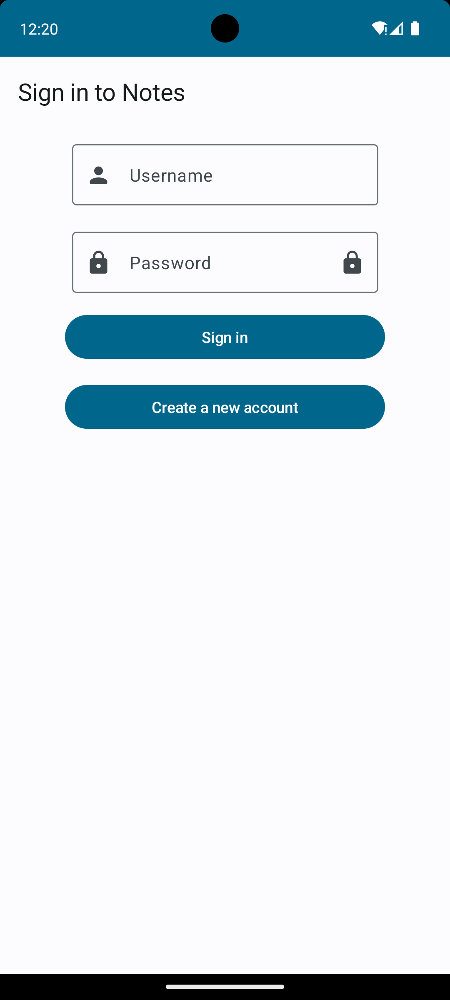
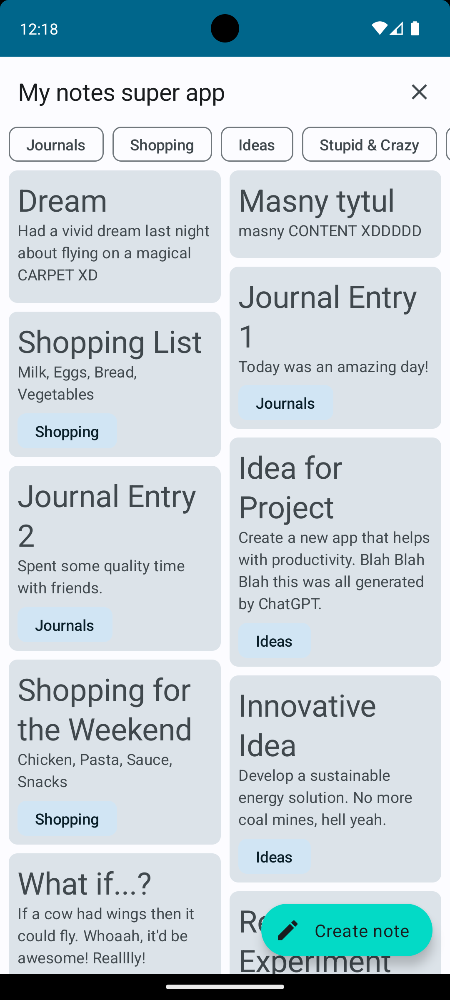
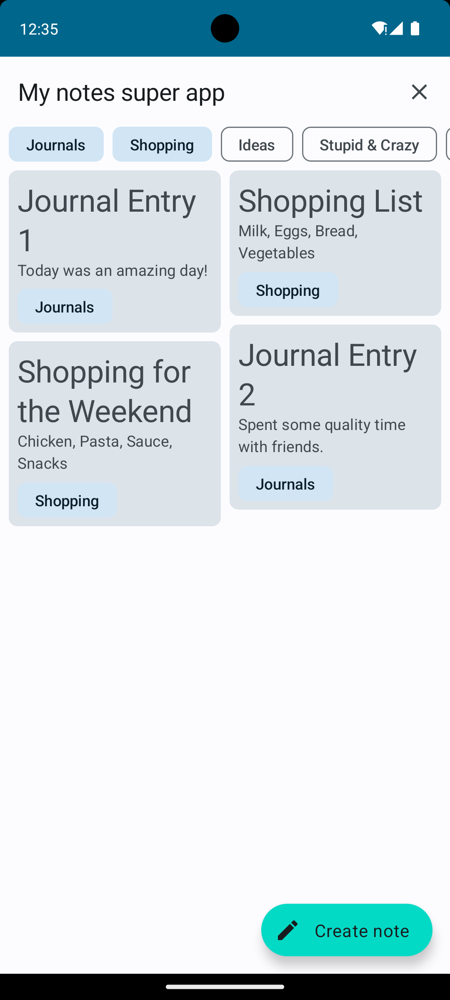
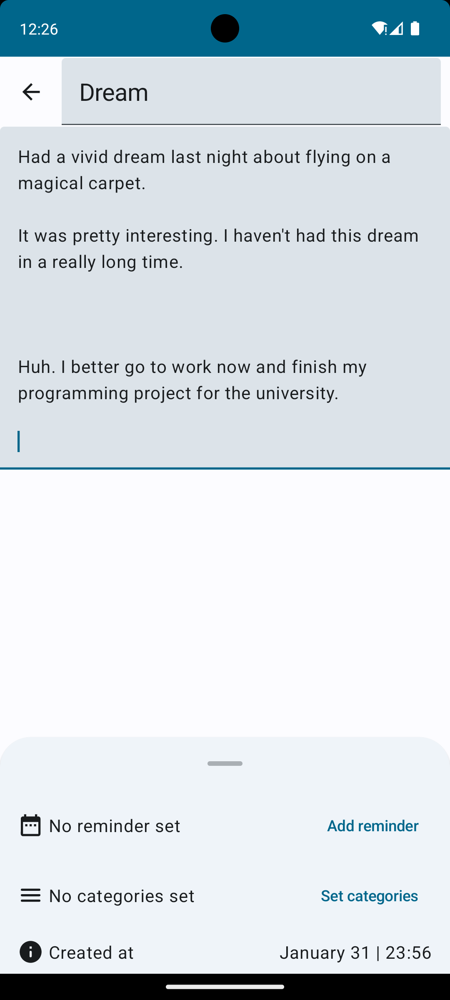
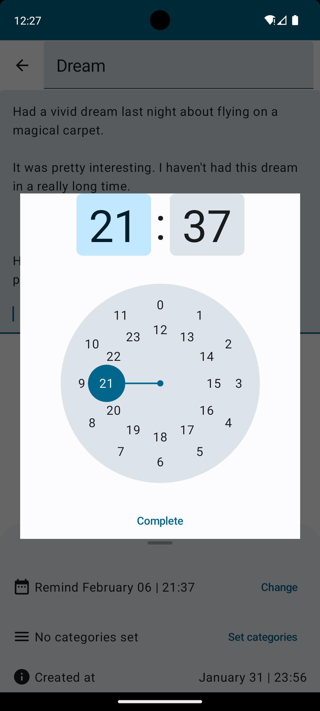
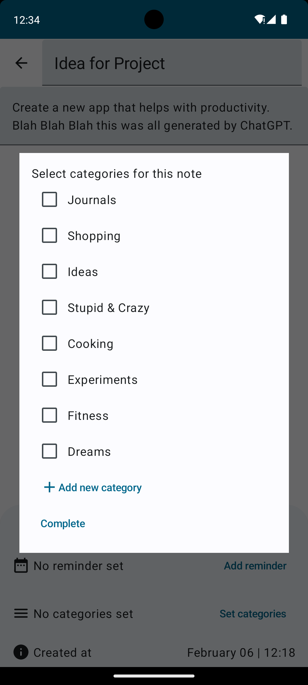
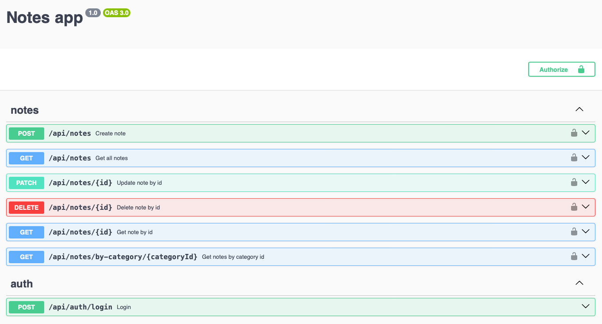
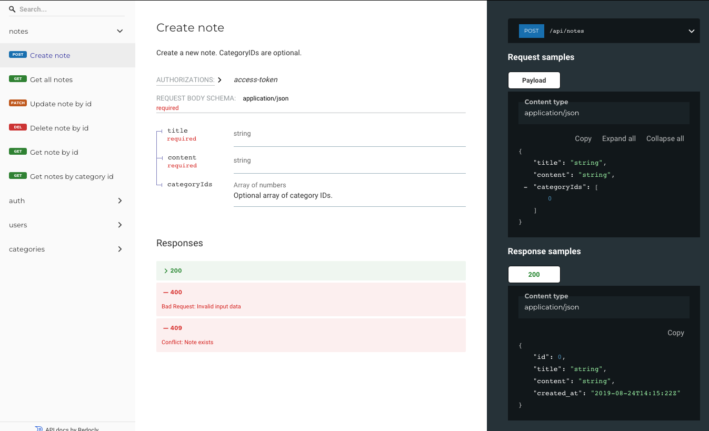

# 📝 Notes

> A complete note-taking solution - a native **Android** app backed by a dedicated **REST API**.

> 🎓 **University project** developed for the _Android System Applications_ course at the
> **Silesian University of Technology** (Politechnika Śląska), Computer Science, 2023/2024.

Notes lets you write and organize your thoughts in a structured way. You can group
notes into categories for faster retrieval, and schedule reminders so important tasks
and information are never forgotten. Because all data lives in an external database
rather than on the device, your notes survive a reinstall and are available across
multiple devices.

---

## ✨ Features

- 🔐 **Account registration & sign in**
- 🗒️ **Create, edit and delete notes**
- 🏷️ **Assign notes to categories** (and create your own categories)
- ⏰ **Configurable reminders** with push notifications for important notes
- ☁️ **Cloud-backed storage** - data is kept in an external database, not locally, so it
  persists after uninstalling the app and is accessible on other devices

---

## 📱 Mobile app

The Android app is written in **Kotlin** using **Jetpack Compose**, Google's modern
declarative UI toolkit, with **Jetpack Compose Navigation** for a smooth flow between
screens. The architecture follows the **MVVM** pattern with **ViewModel** for state and
business logic, and the **Repository** pattern to keep the data layer fully decoupled
from the UI.

| Concern            | Technology                           |
| ------------------ | ------------------------------------ |
| Language           | Kotlin                               |
| UI                 | Jetpack Compose + Compose Navigation |
| Architecture       | MVVM + Repository pattern, ViewModel |
| Networking         | Retrofit (on top of OkHttp)          |
| Push notifications | Firebase Cloud Messaging             |
| Lint & formatting  | detekt                               |

### Screenshots

<table>
  <tr>
    <td align="center"><br/><sub>Sign in &amp; create account</sub></td>
    <td align="center"><br/><sub>Notes list with category filters</sub></td>
    <td align="center"><br/><sub>Notes filtered by category</sub></td>
  </tr>
  <tr>
    <td align="center"><br/><sub>Note editor with reminder, categories &amp; created-at info</sub></td>
    <td align="center"><br/><sub>Setting a reminder time</sub></td>
    <td align="center"><br/><sub>Choosing categories for a note</sub></td>
  </tr>
</table>

See the [mobile README](mobile/README.md) for build details.

---

## 🖥️ Backend

The REST API is built with **Nest.js**, using **Prisma** as the ORM over a
**PostgreSQL** database. Authentication and password hashing are handled by
**Passport** and **bcryptjs**, and **Firebase Cloud Messaging** powers push
notifications delivered to the mobile app. The whole stack is containerized with
**Docker** (Nest.js, Prisma and PostgreSQL) for easy deployment and scaling.

| Concern            | Technology               |
| ------------------ | ------------------------ |
| Framework          | Nest.js                  |
| ORM & database     | Prisma + PostgreSQL      |
| Auth & security    | Passport, bcryptjs       |
| Push notifications | Firebase Cloud Messaging |
| API docs           | Swagger & ReDoc          |
| Containerization   | Docker                   |

The API exposes endpoints for managing notes, categories, users and notifications -
enabling the same data to be used across devices without ever being lost.

### API documentation

The API is documented with both **Swagger** (interactive) and **ReDoc** (clean,
reference-style). Once the backend is running, they are available at
`localhost:3000/api` and `localhost:3000/docs`.

<table>
  <tr>
    <td align="center"><br/><sub>Swagger - interactive API explorer</sub></td>
    <td align="center"><br/><sub>ReDoc - reference documentation</sub></td>
  </tr>
</table>

See the [backend README](backend/README.md) for setup, environment variables and usage examples.

---

## 🗂️ Repository structure

```
notes/
├── backend/   # Nest.js + Prisma REST API
└── mobile/    # Jetpack Compose Android app
```

---

## 🚀 Ideas for future development

- **Offline support** - cache notes locally with Room / SQLite so parts of the app work
  without an internet connection.
- **Dependency injection with Hilt** - replace the current manual injection to make
  dependency management cleaner and less error-prone as the project grows.
- **iOS via Compose Multiplatform** - share the codebase to reach iOS users, adapting
  libraries such as Room, Hilt, ViewModel, Retrofit and OkHttp to run on both platforms.

---

## 👥 Development team

| Name                    | Role                                    |
| ----------------------- | --------------------------------------- |
| **Aleksandra Kacprzak** | Team lead, backend                      |
| **Bartłomiej Pacia**    | Mobile app                              |
| **Piotr Karolak**       | Mobile app, support in additional tasks |

_Gliwice, January 2024_
